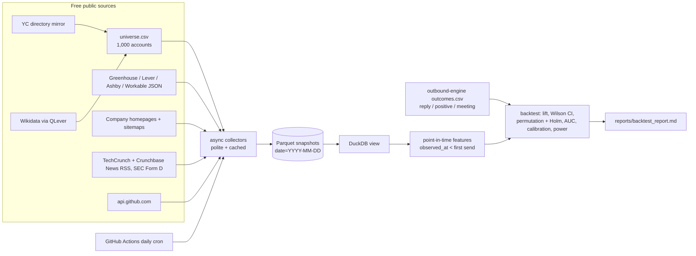

# signal-backtest

**Which buying signals actually predict a reply?** A signal model for one outbound niche,
built to be *backtested against real outcomes*, with signals timestamped before any email
is sent so the backtest has no look-ahead.

> **Status: Week 0 of 8.** Signal collection started on 2026-11-20 (first real snapshot below).
> The real backtest is **pending**: it needs 6-8 weeks of reply / positive-reply / meeting
> outcomes from the `outbound-engine` repo. Until then the only backtest report in this repo is
> a clearly-labelled **synthetic demo** that shows the report format.

## Problem

Outbound tools sell "intent signals" (hiring, funding, tech changes) with no evidence that they
lift reply rates *for your niche*. This repo tests that for one niche: **small/medium digital
agencies and B2B SaaS companies in the US, UK, Canada and Australia that may need website
development help**. These are the prospects of the owner's agency outbound campaign.

The honest way to test a signal is to record it **before** the email goes out, then compare
reply rates with and without the signal, with confidence intervals, a significance test,
multiple-testing correction, and a power analysis that says how much data you need.

## What's built

| Part | What it does |
|---|---|
| `universe` | Builds 300-1,000 ICP accounts from free sources: the YC directory mirror (B2B SaaS) and Wikidata via QLever (agencies). Company-level data only. ([ADR 0004](docs/adr/0004-account-universe-sources.md)) |
| `collectors/jobs.py` | Greenhouse, Lever, Ashby and Workable public JSON boards. Finds boards from homepage and careers-page links, or guesses the domain stem (flagged as `guess`). Pages that link to many boards are treated as aggregators. Tags roles as web, marketing or design. |
| `collectors/techstack.py` | Detects technologies on the homepage with the open-source Wappalyzer-fork fingerprints, which are downloaded at run time and never vendored (GPL-3.0, [ADR 0003](docs/adr/0003-fingerprint-licence.md)). Groups them as legacy builder, modern builder, WordPress or marketing stack. |
| `collectors/website.py` | Content hash (ignores digits and scripts), structure hash (catches redesigns), sitemap URL count, Last-Modified, and pricing/careers/blog/case-study pages. |
| `collectors/funding.py` | TechCrunch venture and Crunchbase News RSS feeds, plus the SEC EDGAR Form D Atom feed (needs `SEC_USER_AGENT`). Matches items to accounts by domain or exact name. |
| `collectors/github.py` | Org activity via api.github.com (repos pushed in the last 30 days). An optional `GITHUB_TOKEN` raises the limit; without one, 50 orgs per run. |
| `http.py` | Async and polite: a global concurrency cap, per-host limits and delay, robots.txt for websites, backoff on 429/5xx, and an on-disk cache with a TTL. Re-runs on the same day are idempotent. |
| `store.py` | One zstd Parquet file per collector per day, with DuckDB as the query layer ([ADR 0001](docs/adr/0001-parquet-snapshots-duckdb-query.md)). |
| `features.py` | Point-in-time state features plus change events (CMS migration, redesign, marketing tool added, new key page, new web role, sitemap growth, funding) with exponential time decay. |
| `model.py` | Interpretable additive score with **prior** weights, compared against `icp_only` and `random` baselines. |
| `backtest.py` | Per-signal lift with Wilson CIs, permutation p-values, Holm correction, AUC with bootstrap CI, cross-fitted calibration and Brier score, an explicit list of negative and noise results, and a power table ([ADR 0002](docs/adr/0002-lookahead-guard-and-statistics.md)). |
| `.github/workflows/collect.yml` | Daily cron that runs the collectors and commits the compact snapshot to a `data` branch. Actions minutes are free for public repos. |

## Architecture



## Results

### Real data collected now (Week 0 snapshot, 2026-11-20)

These numbers are copied from [`reports/snapshot_summary.md`](reports/snapshot_summary.md),
which `signal-backtest summary` generated from the committed Parquet in `data/snapshots/`.

| | |
|---|---|
| Companies in universe | **1,000** (553 agency-like from Wikidata, 447 B2B SaaS from YC) |
| Homepages fetched OK | 851 (82 returned 403 bot walls, 41 network errors, 21 disallowed by robots.txt) |
| ATS boards found | 157 (88 from links, 69 from domain-stem guesses): Ashby 121, Greenhouse 21, Lever 11, Workable 4 |
| Companies with open roles | 151, with **3,431 open roles** in total |
| Web / frontend roles | 41 roles at 29 companies (17 of them on a linked, non-guessed board) |
| Marketing roles | 293 roles at 71 companies |
| Design roles | 41 roles at 29 companies |
| Tech-stack detections | **1,829** at 708 companies. Groups: marketing stack 365, modern builder 173, WordPress 119, legacy builder (Wix, Squarespace and similar) 31 |
| Sitemaps found | 788. Pages linked: blog 549, case studies 395, careers 293, pricing 286 |
| Funding feeds | TechCrunch 20 items, Crunchbase News 10 items. 7 were funding stories, and **0 matched** a universe account. SEC EDGAR returned **HTTP 403** here. |
| GitHub orgs found | 131, but api.github.com returned **403 for all 131** in the build sandbox (proxy policy). It works in Actions with `GITHUB_TOKEN`. |

Change events (redesigns, CMS migrations, new roles) need at least two snapshots, so they start
appearing after the second daily run.

### Power: how many sends to detect a 2x reply-rate lift

Output of `signal-backtest power` (two-sided alpha 0.05, power 0.8, unequal allocation):

| baseline reply rate | signal on 10% of sends | signal on 20% | signal on 30% | signal on 50% |
|---|---|---|---|---|
| 1% | 11,329 | 6,612 | 5,210 | 4,637 |
| 2% | 5,584 | 3,258 | 2,566 | 2,282 |
| 3% | 3,669 | 2,140 | 1,685 | 1,497 |
| 5% | 2,137 | 1,246 | 980 | 869 |
| 8% | 1,275 | 742 | 583 | 516 |

In plain terms: with a few hundred sends, only large effects on common signals can be detected.
Most signals will honestly come out "inconclusive", and the report says so.

### Backtest: pending (Week 0)

The backtest will measure, for each signal and for each outcome (replied, positive, meeting):
the rate with and without the signal (Wilson CIs), lift, a permutation p-value with Holm
correction, and a verdict. Every non-positive signal is listed explicitly. Ranking AUC is
compared against the ICP-only and random baselines, and calibration is checked.

The format is shown in [`reports/DEMO_backtest_report.md`](reports/DEMO_backtest_report.md).
That report is **synthetic**: the demo plants a 2x effect on `hiring_web`, 1.8x on
`recent_funding` and 0.6x on `github_active`, and the backtest recovers them. It says nothing
about real prospects. Demo accounts end in `.demo-synthetic`, and the CLI refuses to backtest
a real run on them.

## How to run

```bash
make install            # Python 3.11 venv + dev tools
make check              # ruff + mypy --strict + pytest (offline fixtures, no network)
make universe           # rebuild data/universe.csv from YC mirror + Wikidata
make collect            # all collectors -> data/snapshots/date=<today>/*.parquet
make summary            # reports/snapshot_summary.{md,json}
make demo               # SYNTHETIC demo report (format only)
make power              # sends needed for a 2x lift
make backtest OUTCOMES=outcomes.csv   # real backtest once outcomes exist
```

Outcomes CSV format (one row per send, from outbound-engine):
`account_id,sent_at,replied,positive,meeting`. Use the domain as `account_id`, ISO-8601 UTC
for `sent_at`, and 0/1 flags. Owner steps (push, enable Actions, secrets, joining the
prospect list) are in [SETUP.md](SETUP.md).

## Limitations

- **No outcomes yet.** The prior weights in `model.py` are hypotheses, not fitted results.
- **The universe is not the prospect list.** Outbound-engine prospects must be added to
  `data/universe.csv` and collected for at least one day before they are emailed, otherwise
  the look-ahead guard excludes them.
- **Wikidata "agencies"** come from marketing and advertising industry tags. They include some
  large agency networks and some martech or media companies. The ≤1,000 employee filter only
  applies where Wikidata records a headcount.
- **Guessed ATS boards** (69) can belong to a different company with the same token. They are
  flagged `method=guess` and can be excluded. Pages that link to more than 3 boards are treated
  as aggregators. One YC company's homepage linked 328 other companies' Ashby boards.
- **Bot walls.** 82 homepages returned 403. Their tech stack and website signals are missing,
  not negative.
- **Funding coverage is thin.** The RSS feeds only hold about 30 recent items, so coverage
  builds up through daily collection. SEC EDGAR needs a contact User-Agent and was blocked here.
  Name matching has low precision for dictionary-word names.
- **GitHub** was blocked in the build sandbox. Its signal will only exist from Actions runs.
- **Ashby role tagging** uses titles and departments only. Job descriptions are not stored.

## Compliance

Only company-level public data is collected: domains, public job titles, technology names, page
hashes and counts. No personal data, no page bodies, no email addresses. robots.txt is honoured
for websites, and requests are rate-limited per host. The outcomes file needs no personal data
(domain + timestamps + 0/1 flags). Suppression, unsubscribe and CAN-SPAM/GDPR/DPDP obligations
for the emails themselves live in outbound-engine.

## License

MIT (code). The fingerprint data downloaded at run time is GPL-3.0 and is not redistributed.
